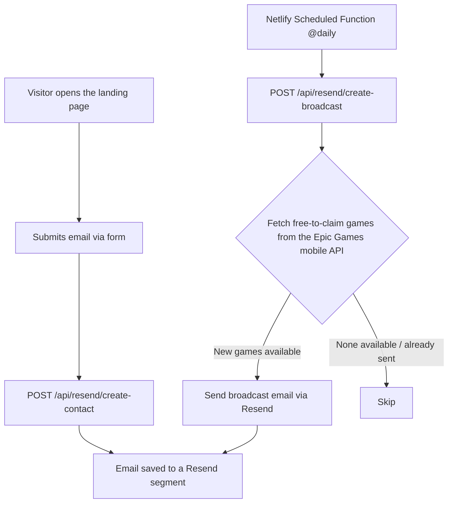

# LOOTDROP — Free Epic Games Mobile Drop Alerts

An email notification landing page for **free Epic Games mobile games (Android & iOS)**.
Visitors enter their email, which is stored in a [Resend](https://resend.com)
segment, and every day the system automatically checks for free-to-claim games on
the Epic Games mobile store and sends a broadcast email with official claim links.

This project is built with **Nuxt 4** (Nitro server) and deployed on **Netlify**.

> Not affiliated with Epic Games, Inc. — just a notification aggregator linking to the official store.epicgames.com pages.

## How It Works



1. **Landing page** (`app/`) — `app.vue` renders the `LdPage` component, which
   composes `LdHeader`, `LdHero` (subscribe form), `LdTelemetry` (demo cards),
   and `LdFooter`.
2. **Subscribe** — the form in `LdHero` validates the email with Zod, then calls
   `POST /api/resend/create-contact`, which creates a new contact in Resend
   under the configured segment.
3. **Daily broadcast** — the Netlify Scheduled Function
   (`netlify/functions/scheduled-create-broadcast.mts`, cron `@daily`) calls
   `POST /api/resend/create-broadcast` with a Bearer token.
4. **Free game detection** — the broadcast endpoint calls `fetchEpicFreeGames()`
   in `server/utils/epic.ts`, which reads
   `https://egs-platform-service.store.epicgames.com/api/v2/public/discover/home`
   with `platform=android`, then filters for `Claim` offers priced at 0 that
   haven't ended yet.
5. **Send email** — the HTML email is built by `buildBroadcastHtml()`
   (`server/utils/broadcast-template.ts`) and sent as a Resend broadcast with
   `send: true`. Idempotent: the broadcast name `free-games:<slug1>+<slug2>`
   prevents duplicate sends.

## Project Structure

```
.
├── app/
│   ├── app.vue                    # Entry point, renders <LdPage />
│   ├── assets/css/tailwind.css    # Global styles + custom utilities
│   └── components/
│       ├── LdHeader.vue           # Sticky navbar with logo & CTA
│       ├── LdHero.vue             # Hero + email subscribe form
│       ├── LdTelemetry.vue        # "Radar" demo cards (static sample data)
│       ├── LdPage.vue             # Layout wrapper
│       ├── LdFooter.vue           # Footer
│       └── ui/                    # shadcn components (badge, button, card, input)
├── server/
│   ├── api/resend/
│   │   ├── create-contact.post.ts   # Save subscriber email
│   │   └── create-broadcast.post.ts # Send free-game broadcast (Bearer token)
│   ├── plugins/dns-ipv4first.ts     # Force IPv4 DNS resolution first
│   └── utils/
│       ├── epic.ts                  # fetchEpicFreeGames + withRetry
│       ├── broadcast-template.ts    # HTML email template
│       └── resend.ts                # Resend client instance
├── netlify/functions/
│   └── scheduled-create-broadcast.mts  # Daily scheduler (@daily)
├── public/                          # favicon, robots.txt
└── nuxt.config.ts                   # Runtime config & shadcn-nuxt module
```

## Setup

### 1. Install dependencies

```bash
# npm
npm install

# pnpm
pnpm install

# yarn
yarn install

# bun
bun install
```

### 2. Environment variables

Create a `.env` file (see `.gitignore` — it is not committed):

```bash
RESEND_API_KEY="re_xxxxxxxx"       # API key from the Resend dashboard
RESEND_SEGMENT_ID="xxxx"           # Audience segment ID for subscribers
RESEND_FROM="LOOTDROP <onboarding@resend.dev>"  # Sender address
BROADCAST_TOKEN="random-string"    # Token used to secure the broadcast endpoint
```

Generate a strong `BROADCAST_TOKEN` with any random-string tool, e.g.:

```bash
openssl rand -hex 32
# or, if you prefer Node
node -e "console.log(require('crypto').randomBytes(32).toString('hex'))"
```

Copy the output into `BROADCAST_TOKEN` (in `.env` for local, and in the Netlify
environment variables — both must match).

For the Netlify scheduled function, make sure `SITE_URL` (or `URL` /
`DEPLOY_PRIME_URL`) points to the production deploy URL, e.g.
`https://lootdrop.netlify.app`.

Note: `RESEND_FROM` must use a domain verified in Resend to avoid emails
landing in spam. The `onboarding@resend.dev` address can only send to your own
Resend account (for testing).

## Running the App

### Development server

```bash
# npm
npm run dev

# pnpm
pnpm dev

# yarn
yarn dev

# bun
bun run dev
```

Open `http://localhost:3000`.

### Build for production

```bash
# npm
npm run build

# pnpm
pnpm build

# yarn
yarn build

# bun
bun run build
```

### Preview the production build

```bash
# npm
npm run preview

# pnpm
pnpm preview

# yarn
yarn preview

# bun
bun run preview
```

See the [Nuxt deployment documentation](https://nuxt.com/docs/getting-started/deployment) for more information.

## API Endpoints

| Method | Path                              | Auth                | Description |
| ------ | --------------------------------- | ------------------- | ----------- |
| `POST` | `/api/resend/create-contact`      | —                   | Adds a subscriber email to the Resend segment. Body: `{ email: string }` |
| `POST` | `/api/resend/create-broadcast`    | `Bearer <BROADCAST_TOKEN>` | Fetches free games from Epic, then sends the broadcast email. Optional body `{ testTo?: string }` for a test send. |

Example test broadcast (e.g. after deploying):

```bash
curl -X POST https://<site-url>/api/resend/create-broadcast \
  -H "Authorization: Bearer $BROADCAST_TOKEN" \
  -H "Content-Type: application/json" \
  -d '{"testTo":"you@example.com"}'
```

If there are no active free games, or a broadcast with the same name was
already sent, the endpoint responds with `{ skipped: true, reason: ... }`
without sending an email.

## Scheduled Broadcast

`netlify/functions/scheduled-create-broadcast.mts` uses
[Netlify Scheduled Functions](https://docs.netlify.com/functions/scheduled-functions/)
with `schedule: '@daily'`. Each day this function:

1. Reads the event payload (containing `next_run`) for logging.
2. Verifies `SITE_URL` and `BROADCAST_TOKEN` are available.
3. `POST`s to `${SITE_URL}/api/resend/create-broadcast` with the Bearer token.
4. Returns `200` on success, `502` if the endpoint call fails.

Since the broadcast endpoint is token-protected, make sure `BROADCAST_TOKEN`
in the Netlify environment matches the value in the Nuxt/Netlify Site
environment exactly. Generate it with `openssl rand -hex 32` (see
[Setup](#2-environment-variables)) and set the same value in both places.

## Tech Stack

- [Nuxt 4](https://nuxt.com/docs) — full-stack Vue 3 framework (Nitro server)
- [Tailwind CSS v4](https://tailwindcss.com) — styling
- [shadcn-nuxt](https://www.shadcn-nuxt.com) + [Reka UI](https://reka-ui.com) — UI components
- [vee-validate](https://vee-validate.logaretm.com) + [Zod](https://zod.dev) — form validation
- [Resend](https://resend.com) — email delivery & broadcasts
- [Netlify Functions](https://docs.netlify.com/functions/) — daily scheduled job
- [@phosphor-icons/vue](https://phosphoricons.com) — icons

## License

Private project. The "LOOTDROP" name and visual assets are part of this
project and are not affiliated with Epic Games, Inc.
